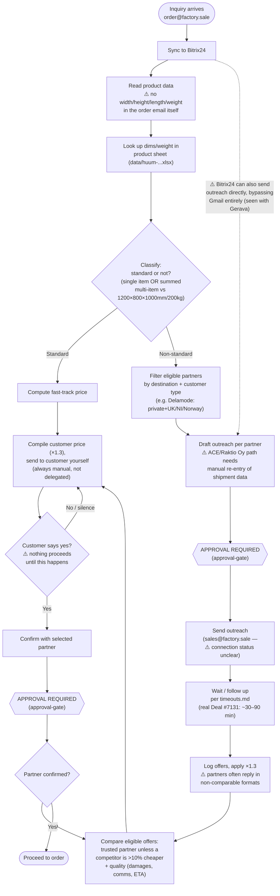

# Transportation partner selection — Current state

> Imported verbatim from `fs-vault-sync:vault-ops/discovery-maps/current-state.md` (file time 2026-09-16 12:30, sha256 `f6eb5de24918e20d…`) on 2026-10-11: the Mermaid map of the process as practised, with the pain points; the notes below the diagram carry the anchors. Recorded fields: title: "Transportation partner selection — Current state", process: Transportation partner selection, state: current, interviewee: Operator (order@factory.sale), date: 2026-09-16, tags: [process, discovery, diagram]. Written in the operator's instance vault by the operator's Claude Desktop during the discovery round; the operator is Eva, [[PER-eva]]. Wiki-links are rewritten to this vault's ids; a file that is not a node reads `fs-vault-sync:path`. The shared folder's copy may move on, this text does not.

> Node legend: `[rect]` deterministic/system step · `{diamond}` decision ·
> `([round])` start/end · **⚠️** pain point (see the opportunities [[OPP-FS-0001]] ... [[OPP-FS-0006]] for details). ^q01

## Notes
- Systems touched: Bitrix24, `order@factory.sale` → Gmail (`evaprual.factorysale@gmail.com`),
  `sales@factory.sale` (partner channel, connection status open — see
  [[SRC-20260916-ops-open-setup-items]] #1–2), the ACE/Raktio Oy semi-automated request tool, the
  offer-log Google Sheet, the HUUM product dimension sheet. ^n01
- Handoffs: Bitrix24/webshop → operator (in); operator → transport partners → operator (offer
  round-trip); operator → customer → operator (price confirmation round-trip); operator → chosen
  partner (final confirm). One person (the operator) holds the entire process end to end — no
  handoff to a colleague was identified. ^n02
- Exceptions not shown as a step (they interrupt at delivery, not before): truck can't access
  site (road conditions), customer forgets they must organize unloading, new-development address
  can't be found — see [[OPP-FS-0001]],
  [[OPP-FS-0002]],
  [[OPP-FS-0003]]. ^n03
- Pain points marked ⚠️ above are detailed in the opportunities list
  ([[OPP-FS-0001|OPP-0001]] through
  [[OPP-FS-0006|OPP-0006]]) and in
  `operating/findings-inbox/`. ^n04
