# Transportation partner selection — DESIRED — proposal

> Imported verbatim from `fs-vault-sync:vault-ops/discovery-maps/desired-state.md` (file time 2026-09-16 12:49, sha256 `ccb84274db55484f…`) on 2026-10-11: a proposal, not a decision: the agent-drafted steps, the pre- and post-graduation approval gates, the open design questions. Recorded fields: title: "Transportation partner selection — Desired state (proposal)", process: Transportation partner selection, state: desired, interviewee: Operator (order@factory.sale), date: 2026-09-16, tags: [process, discovery, diagram, proposal]. Written in the operator's instance vault by the operator's Claude Desktop during the discovery round; the operator is Eva, [[PER-eva]]. Wiki-links are rewritten to this vault's ids; a file that is not a node reads `fs-vault-sync:path`. The shared folder's copy may move on, this text does not.

> This is a proposal, not a decision. Node legend: `[rect]` deterministic/system step ·
> `{diamond}` decision · `([round])` start/end · 🤖 agent-drafted/automated ·
> **⚠️** still-open design question · unchanged from current-state: [[SRC-20260916-map-current-state]].
>
> Ground rules from the interview, corrected 2026-09-16 — [[SRC-20260916-ops-approval-gate]] is a
> **graduated** control, not a permanent one: every outbound email, partner or customer, needs the
> operator's explicit approval **until** the agent has completed 20 successful full
> inquiry-to-order cycles end to end (see [[SRC-20260916-ops-agent-trust-criteria]]), after which the
> agent may send all emails itself without per-send approval. Everything below shows the
> **pre-graduation** state — the only state currently in force, since no cycle count exists yet.
> See "Post-graduation state" below the diagram for what changes once the bar is met. ^q01

```mermaid
flowchart TD
    Start(["Inquiry arrives<br/>order@factory.sale"]) --> BX["Sync to Bitrix24<br/>(incl. Gerava-style direct<br/>partner outreach — see<br/>open item #10)"]
    BX --> RD["🤖 Agent reads product data<br/>by SKU/Art.Nr., not free-text<br/>name matching (item #8)"]
    RD --> LOOKUP["🤖 Agent looks up dims/weight<br/>in product sheet automatically"]
    LOOKUP --> CLS{"🤖 Agent classifies:<br/>standard or not?<br/>applies reworded rule —<br/>single item OR summed multi-item<br/>vs 1200×800×1000mm/200kg<br/>(item #5)"}
    CLS -- Standard --> FT["🤖 Agent computes<br/>fast-track price"]
    FT --> CUST
    CLS -- Non-standard --> ELIG["🤖 Agent filters eligible partners<br/>by destination + customer type<br/>(offer-selection-rule Step 0,<br/>already fully specified)"]
    ELIG --> DRAFT["🤖 Agent drafts outreach per partner<br/>— dimensions pulled straight from<br/>product sheet, no manual re-entry<br/>into ACE/Raktio Oy (item #14)"]
    DRAFT --> APR1{{"APPROVAL REQUIRED<br/>operator reviews & approves<br/>(unchanged — approval-gate)"}}
    APR1 --> SEND["Send outreach as<br/>sales@factory.sale<br/>(once item #1 confirmed)"]
    SEND --> WAIT["Wait / follow up<br/>per timeouts.md<br/>— agent tracks, operator<br/>only sees exceptions"]
    WAIT --> LOG["🤖 Agent logs offers, applies ×1.3<br/>⚠️ still needs like-for-like offers<br/>from partners to compare cleanly<br/>(non-comparable-formats problem<br/>doesn't disappear just because<br/>an agent is logging)"]
    LOG --> CMP["🤖 Agent ranks offers:<br/>trusted partner unless a<br/>competitor is &gt;10% cheaper<br/>+ quality (damages, comms, ETA)<br/>— encodes offer-selection-rule"]
    CMP --> REVIEW{"Operator makes the<br/>final decision<br/>(unchanged — not delegated,<br/>per operator: 'kõik peale<br/>lõpliku otsuse')"}
    REVIEW --> CUST["🤖 Agent drafts customer price<br/>(×1.3) — ⚠️ open design question:<br/>operator currently sends this<br/>personally; may stay operator-only<br/>or move to drafted+approved like<br/>partner mail"]
    CUST --> APR1b{{"APPROVAL REQUIRED<br/>before customer email sends<br/>(unchanged — approval-gate)"}}
    APR1b --> CWAIT{"Customer says yes?"}
    CWAIT -- No / silence --> CUST
    CWAIT -- Yes --> CONF["🤖 Agent drafts confirmation<br/>to selected partner"]
    CONF --> APR2{{"APPROVAL REQUIRED<br/>(unchanged — approval-gate)"}}
    APR2 --> PCONF{"Partner confirmed?"}
    PCONF -- No --> CMP
    PCONF -- Yes --> ORD(["Proceed to order"])
```

## Post-graduation state (after 20 successful full cycles)
The diagram above shows every send gated by `APPROVAL REQUIRED`. Once the operator confirms the
agent has completed 20 successful inquiry-to-order cycles end to end (with the log
[[SRC-20260916-ops-agent-trust-criteria]] requires), **all three approval gates (APR1, APR1b, APR2)
drop out** — the agent drafts and sends outreach, the customer price email, and the partner
confirmation itself, with no per-send review. The operator still makes the final offer-choice
decision (REVIEW node — unchanged either way) and can still review the log at any time. The
operator triggers this transition by telling the agent directly once 20 cycles are done — there
is no automated counter — see [[SRC-20260916-ops-open-setup-items]] item #13. ^n01

## What changes vs. [[SRC-20260916-map-current-state]]
- Product-data lookup, classification, partner eligibility filtering, outreach drafting, offer
  logging/normalization, and offer ranking move from manual operator work to agent-drafted work
  (🤖). None of this changes who can send an email — see below. ^n02
- The ACE/Raktio Oy manual re-entry step ([[OPP-FS-0004]]) is
  gone in this proposal, but only once item #14 (how that tool actually accepts input) is
  investigated — it's drawn here as solved, but the investigation itself is not done. ^n03
- What does **not** change, pre-graduation: [[SRC-20260916-ops-approval-gate]] on every outbound email;
  the operator still makes the final offer-choice decision personally (not delegated); the
  customer still gets a "yes/no" gate before anything with the partner is finalized. Post-
  graduation, only the send-approval requirement lifts — the final-decision step and the
  customer yes/no gate are unaffected either way (see "Post-graduation state" above). ^n04

## Open design questions (not decided — flagged, not resolved, by this map)
1. ~~**Who sends the customer price email?**~~ — Resolved by the 2026-09-16 correction: the agent
   may draft it (as shown) pre-graduation, under approval-gate like partner mail, and may send it
   itself post-graduation, same as any other email. What's still not asked directly: whether the
   operator is comfortable with the agent drafting/sending the *customer-facing* email
   specifically, as opposed to only partner mail — the correction answered the general rule, not
   this specific case by name. ^n05
2. ~~**Trust ramp-up mechanics.**~~ — Resolved 2026-09-16: no automated counter or self-reported
   threshold. The operator will tell the agent directly once 20 cycles are done ("Me anname ise
   teada, kui 20 tsüklit on edukalt läbitud"). Until that explicit go-ahead, this desired state
   runs in its pre-graduation form, regardless of how many cycles have actually run. Still open:
   whether a running log of cycles is kept anywhere for the operator to judge against (the log
   itself stays required per [[SRC-20260916-ops-agent-trust-criteria]]). ^n06
3. **Item #10 dependency.** The Bitrix24-direct-outreach path (Gerava-style) needs to be visible in
   the same trail as Gmail before an agent can reliably act on *all* partner outreach, not just the
   sales@factory.sale-routed kind — this also affects what counts toward the 20-cycle total. ^n07

## Artifacts referenced
[[SRC-20260916-map-current-state]] · [[SRC-20260827-ops-classification-rule]] · [[SRC-20260909-ops-offer-selection-rule]] ·
[[SRC-20260916-ops-agent-trust-criteria]] · [[SRC-20260916-ops-approval-gate]] ·
[[SRC-20260916-ops-open-setup-items]] (items #1, #5, #8, #10, #13, #14) ·
[[FIND-FS-0015]] ·
[[OPP-FS-0004]] ·
[[OPP-FS-0005]] ·
[[OPP-FS-0006]] ^n08
