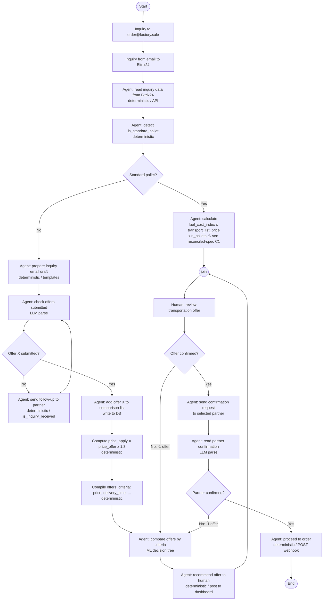

# Process Flow

> Imported verbatim from `fs:vault/10-spec/process-flow.md@89d77d2` on 2026-10-11 (first committed 2026-07-16): redrawn in the repository from the flowchart SVG of 2026-06-18. Wiki-links are rewritten to this vault's ids; a link to a repository file that is not a node reads `fs:path@commit`. The repository's copy may move on, this text does not — a sweep records changes as new records or `Update` lines.

Redrawn from the original flowchart SVG. Node kinds: **deterministic** (rectangles),
**decision** (diamonds), **LLM/agent parse**, **human**. See [[SRC-fs-process-steps]] for the
numbered narrative.

## Open callouts carried from the original diagram

- **How is the transportation partner selected for a standard pallet?** — the fast-track
  branch computes a price but the diagram leaves partner selection unspecified.
  See [[SRC-fs-reconciled-spec#^C2]].
- **List of criteria to select the best transportation offer** — currently `price` and
  `delivery_time` only (per stakeholder answer), with "additional factors" reserved.
